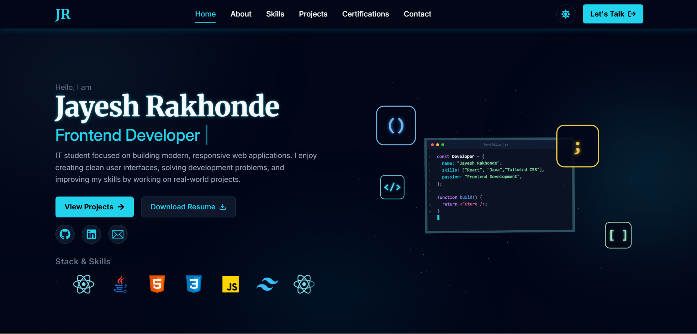

# Jayesh Rakhonde | Personal Portfolio

A modern, responsive personal portfolio website built with React and Tailwind CSS to showcase my skills, projects, certifications, and professional profile. The website features smooth animations, interactive 3D visuals, dark and light themes, and a functional email contact form.


🌐 **Live Demo:** [jayeshrakhonde.vercel.app](https://jayeshrakhonde.vercel.app/)

💻 **GitHub Repository:** [jayeshrakhonde-portfolio](https://github.com/Jayeshrakhonde07/jayeshrakhonde-portfolio)

---

## 📌 About the Project

This portfolio website presents my journey as a developer, highlighting my technical skills, projects, certifications, and contact information in a clean and interactive interface.

It is built with reusable React components and a modular project structure, making the code easier to maintain, extend, and improve.

## ✨ Features

- **Responsive Design:** Works across desktop, tablet, and mobile devices.
- **Animated Hero Section:** Dynamic role text, smooth transitions, and interactive elements.
- **Interactive 3D Visuals:** 3D elements powered by Three.js and React Three Fiber.
- **About Me:** Personal information, education, interests, and development highlights.
- **Skills Section:** Displays technical skills with category-based filtering.
- **Projects Showcase:** Project cards with descriptions, technologies, live demos, and GitHub links.
- **Certifications:** Displays certificates with options to view credentials.
- **Resume Download:** Allows visitors to access my resume.
- **Contact Form:** Sends messages through EmailJS.
- **Toast Notifications:** Provides feedback after contact form submissions.
- **Dark and Light Themes:** Supports a theme-aware browsing experience.
- **Social Links:** Quick access to GitHub, LinkedIn, and email.
- **Reusable Components:** Modular React architecture for maintainability.
- **Accessibility Considerations:** Respects reduced-motion preferences.

## 🛠️ Tech Stack

### Frontend

- React 19
- JavaScript (ES6+)
- Tailwind CSS v4
- HTML5
- CSS3

### Animation and 3D

- Framer Motion
- Three.js
- React Three Fiber
- React Three Drei

### Libraries and Tools

- React Icons
- React Toastify
- EmailJS
- Vite
- Oxlint
- Git and GitHub
- Vercel

## 📂 Project Structure

```text
jayeshrakhonde-portfolio/
├── public/
│   └── favicon.svg
├── src/
│   ├── assets/
│   │   ├── documents/
│   │   │   ├── certificates/
│   │   │   └── resume/
│   │   ├── icons/
│   │   └── images/
│   │       ├── certifications/
│   │       ├── profile/
│   │       └── projects/
│   ├── components/
│   │   ├── common/
│   │   ├── layout/
│   │   │   ├── Footer/
│   │   │   └── Navbar/
│   │   ├── sections/
│   │   │   ├── About/
│   │   │   ├── Certifications/
│   │   │   ├── Contact/
│   │   │   ├── Hero/
│   │   │   ├── Projects/
│   │   │   └── Skills/
│   │   └── UI/
│   ├── context/
│   │   └── PortfolioProvider.jsx
│   ├── data/
│   ├── hooks/
│   ├── App.jsx
│   └── main.jsx
├── index.html
├── package.json
├── package-lock.json
└── README.md
```

## 🚀 Getting Started

Follow these steps to run the project locally.

### Prerequisites

Make sure you have installed:

- [Node.js](https://nodejs.org/)
- npm (included with Node.js)
- Git

### 1. Clone the Repository

```bash
git clone https://github.com/Jayeshrakhonde07/jayeshrakhonde-portfolio.git
```

### 2. Navigate to the Project Directory

```bash
cd jayeshrakhonde-portfolio
```

### 3. Install Dependencies

```bash
npm install
```

### 4. Configure Environment Variables

Create a `.env` file in the project root and add your EmailJS credentials:

```env
VITE_EMAILJS_SERVICE_ID=your_emailjs_service_id
VITE_EMAILJS_TEMPLATE_ID=your_emailjs_template_id
VITE_EMAILJS_PUBLIC_KEY=your_emailjs_public_key
```

Replace the placeholder values with the credentials from your [EmailJS dashboard](https://dashboard.emailjs.com/).

**Important:** Do not commit private secrets or sensitive credentials to GitHub. Only use the EmailJS public key intended for frontend applications, and configure appropriate restrictions in your EmailJS account.

### 5. Start the Development Server

```bash
npm run dev
```

Open the local URL displayed in your terminal, usually `http://localhost:5173`.

## 📜 Available Scripts

| Command           | Description                           |
| ----------------- | ------------------------------------- |
| `npm run dev`     | Starts the development server         |
| `npm run build`   | Creates a production build            |
| `npm run preview` | Previews the production build locally |
| `npm run lint`    | Runs Oxlint to check code issues      |

## 📁 Featured Projects

### 1. Personal Portfolio

A responsive portfolio website featuring 3D visuals, animations, skills, certifications, and a contact form.

- Interactive 3D visuals and animated hero section.
- Resume download and social media links.
- EmailJS contact form with toast notifications.

**Technologies:** React, Tailwind CSS, Framer Motion, EmailJS, Three.js.

- [Live Demo](https://jayeshrakhonde.vercel.app/)
- [Source Code](https://github.com/Jayeshrakhonde07/jayeshrakhonde-portfolio)

### 2. Mini Spotify

A lightweight Spotify-inspired music player with a responsive user interface.

- Simple and user-friendly music player interface.
- Play and pause audio tracks.
- Responsive layout for different screen sizes.

**Technologies:** HTML, CSS, JavaScript.

- [Live Demo](https://spotify-clone-puce-six.vercel.app/)
- [Source Code](https://github.com/Jayeshrakhonde07/Spotify-Clone)

## 🏆 Certifications

The portfolio includes certificates related to:

- HTML
- CSS
- JavaScript
- React and Redux
- React (Basic) — HackerRank
- Git
- GitHub

Visitors can explore the certification section to view the available credentials.

## 📬 Contact

**Jayesh Kishor Rakhonde**

- **Email:** [jayeshrakhonde05@gmail.com](mailto:jayeshrakhonde05@gmail.com)
- **GitHub:** [Jayeshrakhonde07](https://github.com/Jayeshrakhonde07)
- **LinkedIn:** [Jayesh Rakhonde](https://www.linkedin.com/in/jayesh-rakhonde-186b18290/)
- **Portfolio:** [jayeshrakhonde.vercel.app](https://jayeshrakhonde.vercel.app/)

Feel free to connect with me for collaboration, project discussions, and development opportunities.

## 🌐 Deployment

The portfolio is deployed using [Vercel](https://vercel.com/).

To deploy your own version:

1. Push the project to a GitHub repository.
2. Import the repository into Vercel.
3. Configure the required EmailJS environment variables in the Vercel project settings.
4. Deploy the application.

## 🤝 Contributing

Suggestions and improvements are welcome. If you find a bug or have an idea to improve the project, feel free to open an issue or submit a pull request.

## 📄 License

This project is intended to showcase my personal portfolio and development work. If you plan to reuse or redistribute the code, consider adding an explicit license that defines the permitted use.

---

⭐ If you like this project, consider giving the repository a star!

**Built with ❤️ by Jayesh Rakhonde**
